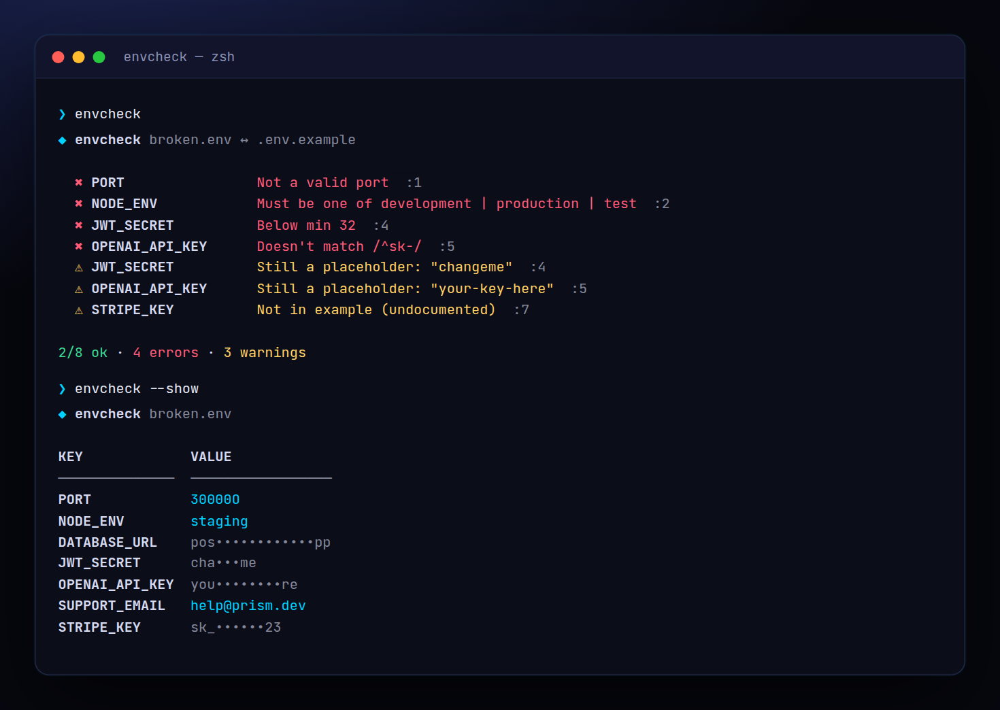

<!-- ═════════════ HEADER ═════════════ -->
<p align="center">
  
</p>

<p align="center">
  
</p>

<p align="center">
  <a href="https://github.com/krishyaa06/prism-env-check/actions/workflows/ci.yml"></a>
  
  
  <a href="LICENSE"></a>
</p>

<p align="center">
  
</p>


## ⚡ Overview

**Prism Env Check** (`envcheck`) compares your `.env` with `.env.example` and tells you exactly what's wrong before your app crashes at runtime: missing keys, empty values, `changeme` placeholders, duplicates and undocumented extras. Add tiny comment annotations to `.env.example` (`# @type=url`, `# @enum=dev|prod`, `# @pattern=^sk-`) and it becomes a typed schema — no extra config file, no dependencies.

## ✨ Features

- Finds **missing, empty, duplicate and placeholder** values (`changeme`, `your-key-here`, `<token>`)
- **Schema in comments**: `@type=url|port|email|int|number|boolean|json`, `@enum=a|b`, `@pattern`, `@min` / `@max`, `@optional`
- `--gen` creates `.env.example` from `.env` with **secrets blanked** and types inferred
- `--show` prints your env with secrets masked (`sk-••••••90`) — safe for screenshots
- `--process` validates the real `process.env` in CI / Docker; `--strict` flags undocumented keys
- Full dotenv parsing: `export`, quotes, inline comments, multi-line values. Exit 1 on errors

## 🚀 Quick Start

```bash
# run without installing
npx github:krishyaa06/prism-env-check 

# or install globally
npm install -g github:krishyaa06/prism-env-check
envcheck --gen
```

Requires Node.js 18.17+. No dependencies.

## 🛠️ Usage

```text
envcheck                         check .env against .env.example
envcheck -e .env.local -x .env.example
envcheck --gen                   create .env.example from .env (secrets blanked)
envcheck --show                  print .env with secrets masked

  -e, --env <file>       env file          (default: .env)
  -x, --example <file>   example / schema  (default: .env.example)
      --process          check process.env instead of a file
      --strict           undocumented keys are errors
      --json             machine-readable output
```

### Schema annotations

```bash
# .env.example
PORT=3000              # @type=port
NODE_ENV=development   # @enum=development|production|test
DATABASE_URL=          # @type=url
JWT_SECRET=            # @min=32 @secret
OPENAI_API_KEY=        # @pattern=^sk-
DEBUG=false            # @type=boolean @optional
```

Every key is **required** unless marked `@optional`. Annotations can be inline or on the comment line above.

### Run before dev

```json
"scripts": { "predev": "envcheck" }
```

## 📁 Project Structure

```text
prism-env-check/
├── assets/
│   ├── logo.png
│   └── logo.svg
├── bin/
│   └── envcheck.js   # CLI entry
├── examples/
│   ├── .env.example   # annotated schema example
│   └── broken.env   # demo env with mistakes
├── src/
│   ├── index.js   # parser, schema, checker, generator
│   └── ui.js   # colours, tables
├── test/
│   └── envcheck.test.js
├── .gitignore
├── LICENSE
├── README.md
└── package.json
```

## 🧪 Tests

```bash
npm test
```

Tests use the built-in `node:test` runner, so there is nothing to install. CI runs them on Node 20 and 22.

## 🤝 Contributing

1. Fork the repo and create a branch: `git checkout -b feature/my-idea`
2. Make your change and add a test in `test/`
3. Run `npm test` and open a Pull Request

## 🔷 Part of Prism Protocol

Prism Env Check is one of the open-source tools built by [Prism Protocol](https://dc.gg/prismprotocol), a tech community where young builders learn, ship and compete together.

## 👤 Author

<table>
  <tr>
    <td align="center">
      <a href="https://github.com/krishyaa06"><br><b>Soumya Bhandare</b></a><br>
      <sub>Founder @ Prism Protocol</sub>
    </td>
    <td>
      <a href="https://dc.gg/prismprotocol"></a><br>
      <a href="https://instagram.com/prism_protocol_"></a><br>
      <a href="https://x.com/krishyaa06"></a>
    </td>
  </tr>
</table>

## 📄 License

Released under the [MIT License](LICENSE).

<p align="center">
  <b>If you like this project, consider giving it a ⭐</b><br>
  <sub>"Build. Create. Compete." · Made with ⚡ by Prism Protocol</sub>
</p>


